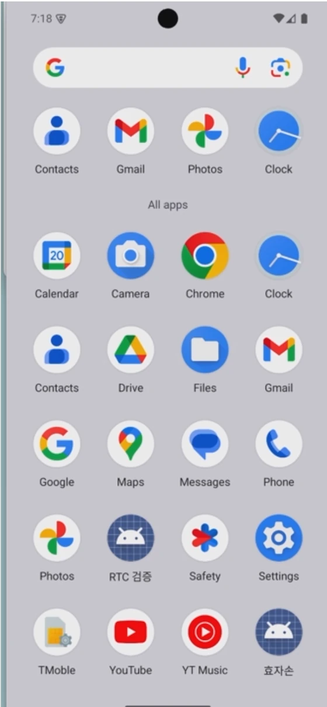
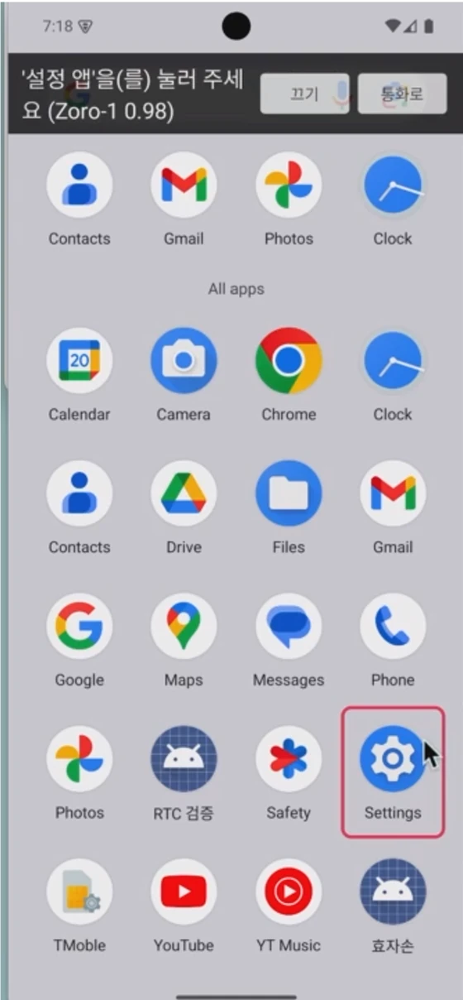
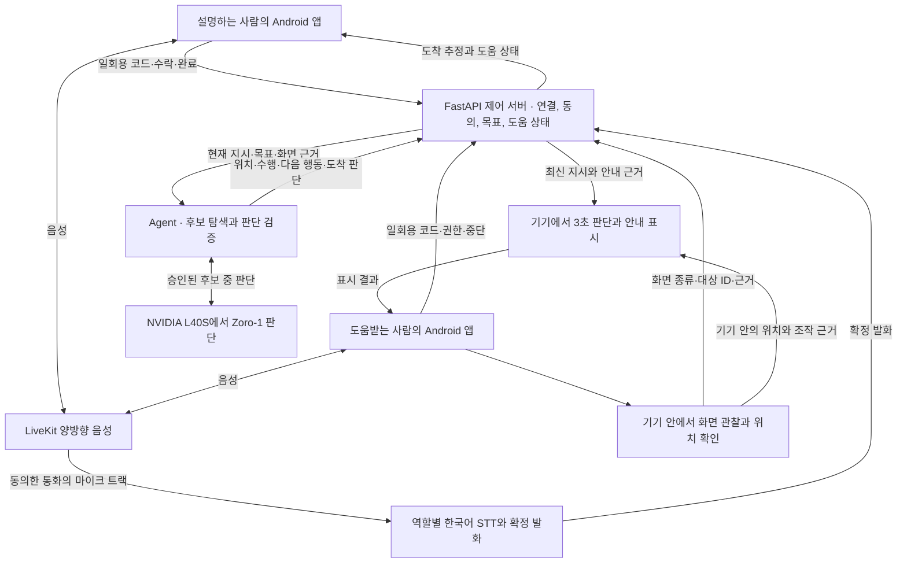
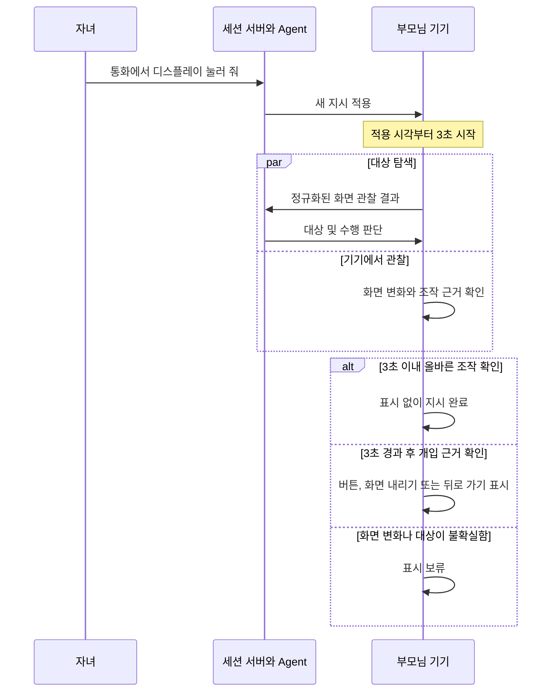

# 효자손 · Hyojason

**가족이 통화 중 말해 준 버튼을 3초 안에 누르지 못하면, 화면에서 찾아 짚어 주는 Android Agent입니다.**

Trillion Labs Hackathon Track 1에서 개발하는 프로토타입입니다. [대회 안내](https://hackathon.trillionlabs.co/)

## 음성 안내 미리보기

가족이 통화 중 설정 앱을 눌러 달라고 말한 예시입니다. 오른쪽 화면에서는 상단 안내문으로 앱 이름을 확인하고, 빨간 테두리가 생긴 **설정(Settings)** 아이콘을 직접 누를 수 있습니다.

| 음성 인식 전 · 앱 목록 | 음성 인식 후 · 설정 앱 안내 |
| :---: | :---: |
|  |  |

## Overview

> “엄마, 설정에서 디스플레이 눌러 줘.”
>
> “디스플레이가 어디 있어? 내 폰에는 안 보이는데.”

전화로 휴대폰 사용을 도울 때 가족은 상대가 어느 화면을 보고 있는지, 메뉴를 이미 눌렀는지 알기 어렵습니다. 같은 앱이라도 기기와 화면 상태에 따라 버튼이 다른 곳에 있거나 스크롤 아래에 숨어 있습니다. 간단한 설정 한 번에도 설명과 확인을 여러 번 주고받게 됩니다.

효자손은 가족을 연결하고 통화와 안내를 관리합니다. 도움받는 사람은 평소 쓰던 Android 설정이나 시계 앱으로 이동해 직접 조작합니다. **통화 중에는 가족이 지시하고, 사용자가 막혔을 때 효자손이 화면에 안내를 표시합니다.** 전화가 끊긴 뒤에는 통화에서 확인한 목표가 남아 있을 때 현재 화면부터 이어서 안내합니다.

## Why Hyojason?

| 상황 | 효자손이 하는 일 |
| --- | --- |
| 전화로 버튼 이름은 들었지만 위치를 모르겠어요. | 자녀가 말한 대상을 현재 화면에서 미리 찾습니다. 3초가 지나도 입력 단서가 없고 위치가 확인되면 앱 위에 빨간 테두리와 큰 글씨를 표시합니다. |
| 버튼을 이미 찾았거나 설명을 듣고 직접 눌렀어요. | 3초 이내에 올바른 조작이 확인되면 안내를 띄우지 않습니다. |
| 메뉴가 화면 아래에 있거나 다른 메뉴에 들어갔어요. | 화면 아래의 위치가 확인되면 **화면 내리기**, 잘못된 조작과 안전한 복귀 경로가 확인되면 **뒤로 가기**를 안내합니다. |
| 전화는 끝났는데 아직 알람을 맞추지 못했어요. | 통화에서 확인한 목표를 가져와 현재 화면에서 다음 행동을 한 단계씩 찾습니다. 목표에 도착한 것으로 보이면 상대에게 알려 줍니다. |

**기기를 조작하는 사람은 사용자입니다.** 효자손은 버튼 위치나 이동 방향을 보여 줍니다. 탭, 입력, 저장, 발송은 사용자가 직접 합니다. 되돌리기 어려운 동작에는 “되돌리기 어려운 동작이에요. 천천히 확인하세요”라는 문구만 띄웁니다. [개입 정책](docs/instruction-policy.md)

**한 번의 도움마다 새로 연결합니다.** 일회용 인증번호로 연결하고 이번에 도움받을 기기를 선택하는 흐름입니다. 발신자와 안내 대상은 따로 정합니다. 연결 상태는 도움 동안 서버 메모리에서 관리합니다. [역할 선택 설계 #6](https://github.com/Bungeo-BeanOrCream/Hyojason/issues/6)

**화면 분석은 도움받는 기기에서 합니다.** 동의한 상태에서 화면 종류와 버튼의 논리 ID, 확인 근거만 제어 서버에 보냅니다. 화면 원본·좌표·OCR 본문은 기기에 머뭅니다. 상대 화면에는 통화 상태와 도착 추정, 도움 완료 등 필요한 제어만 표시합니다. [화면 관찰 계약](docs/screen-observation-profile.md) · [공통 계약](docs/contracts.md)

## Workflow

### 시스템 구성

아래는 통합 MVP의 목표 흐름입니다. 음성 통화 연결과 화면 안내가 같은 도움에 속하더라도, 통화가 끝난 뒤 안내는 이어질 수 있습니다.



### 1. 연결과 동의

1. 한 사람이 효자손에서 **코드 만들기**를 누르고, 상대가 **코드 입력**에서 전달받은 번호를 입력합니다.
2. 양쪽이 연결을 승인한 뒤 이번에 **도움받는 사람**을 확인합니다. 예를 들어 부모님이 전화를 걸어도 부모님 기기에 안내를 표시할 수 있습니다.
3. 통화를 연결하고 AI 분석 동의를 받습니다. 도움받는 기기에서 화면 관찰과 오버레이 권한을 확인합니다. 분석 동의나 권한이 없으면 음성 통화만 이용합니다.

### 2. 통화 중 · 가족이 주도하고 막힐 때 표시

자녀가 “디스플레이 눌러 줘”라고 말하면 한국어 음성 인식(STT)이 발화를 확정하고, Agent가 지시와 목표를 구분합니다. **3초는 부모님 기기가 새 지시를 처음 적용한 시각부터 셉니다.** 위치를 찾는 동안에도 부모님은 조작할 수 있습니다.



오선택이 확인된 경우에도 3초 이후에 검증된 복귀 경로만 안내합니다. 새 자녀 지시가 오면 이전 테두리와 타이머를 지우고 새 지시 기준으로 다시 판단합니다. 부모님의 발화만으로 새 지시나 개입을 시작하지 않습니다. 화면 권한 철회, 보호 화면, 모델 응답 지연, 화면이 바뀐 뒤 도착한 오래된 결과에 대해서는 근거가 확인될 때까지 표시를 보류하거나 기존 표시를 제거합니다. [개입 순서와 조건](docs/instruction-policy.md)

### 3. 통화 후 · 남은 목표 이어받기

예를 들어 자녀가 “내일 오전 6시 알람 맞추자”라고 말한 뒤 전화를 끊어도, 확인된 목표가 있다면 같은 도움에서 안내가 이어집니다. 통화 중 지시와 타이머는 정리하고, 이어받은 모드에서 화면이 안정되면 다시 3초를 셉니다. 현재 화면에서 필요한 행동 한 가지를 골라 안내합니다.

부모님이 알람을 저장하면 날짜·시각·활성 상태를 확인합니다. 목표에 도착한 것으로 판단되면 자녀에게 알리고, 자녀가 **도움 완료**를 누르면 세션을 정리합니다. 목표가 확인되지 않았으면 후속 안내를 시작하지 않습니다. 도움받는 사람은 언제든 **안내 끄기**를 선택할 수 있고, 다음 도움은 새 번호로 연결합니다. [상태 전이](docs/architecture.md) · [알람 데모 절차](docs/scenarios.md#라이브-b--통화-후-알람-안내-이어받기)

### 주요 구성 요소

| 구성 | 기술과 역할 |
| --- | --- |
| Android 앱 | Kotlin. 같은 APK에서 두 역할을 실행합니다. `MediaProjection`으로 동의한 기기의 화면을 관찰하고 로컬 오버레이로 안내합니다. [Android 실행 안내](android/README.md) |
| 통화·음성 인식 | LiveKit으로 양방향 음성을 연결하고 역할별 한국어 STT 결과를 `speech.final`로 확정합니다. [B 브랜치 구현](https://github.com/Bungeo-BeanOrCream/Hyojason/tree/B/server/voice) |
| 세션 제어 | Python과 FastAPI. HTTP·WebSocket으로 통화와 도움 상태, 목표, 화면 관찰 이력, 역할별 표시 이벤트를 관리합니다. [세션 서버](server/session/README.md) |
| Agent | Zoro-1은 목표, 버튼의 위치, 지시 수행 여부를 판단합니다. 통화 후에는 다음 행동과 목표 도착을 판단합니다. Agent가 후보를 제한하고 결과의 화면·지시 버전을 확인합니다. [판단 파이프라인](server/agent/README.md) · [Zoro-1 모델 카드](https://huggingface.co/trillionlabs/Zoro-1) |
| 리허설과 모델 운영 | N-24는 데모 환경을 점검하고, N-25는 기록을 평가합니다. N-26은 실제 모델 요청과 GPU 예산의 준비 상태를 점검합니다. [리허설 도구](demo/fixtures/README.md) · [모델 운영](server/ops/README.md) |

## Roadmap

현재 `main`에는 Android 관찰·오버레이 모듈, Agent 판단, 세션 제어와 리허설 도구가 반영되어 있습니다. 통화·STT는 B의 PR에서 Android API 35 에뮬레이터 한 대와 테스트 클라이언트로 양방향 음성과 설정 앱을 연 상태의 STT를 확인했습니다. 두 Android 기기에서 확정 발화가 실제 화면 안내로 이어지는 통합 검증은 남아 있습니다. [통화·STT PR #18](https://github.com/Bungeo-BeanOrCream/Hyojason/pull/18) · [통합 분담 #10](https://github.com/Bungeo-BeanOrCream/Hyojason/issues/10)

| 단계 | 목표와 검증 기준 |
| --- | --- |
| **모듈 기반** · 확인 | 모의 입력으로 Android 관찰·안내 정책, Agent 판단, 세션 상태를 검증합니다. 실제 Zoro-1은 NVIDIA L40S에서 다섯 판단을 각 1회 호출해 기대 선택과 일치했습니다. 워밍업 후 모델 API 왕복은 430–520ms였습니다. [실모델 스모크 결과 #12](https://github.com/Bungeo-BeanOrCream/Hyojason/issues/12) |
| **MVP 통합** · 진행 중 | B·D의 통화 및 인증을 연결하고, 확정문 → C 판단 → Android 오버레이를 이어 붙입니다. 정상 조작 시 무표시, 무입력 시 위치 표시, 권한 철회와 지연 시 표시 억제를 확인합니다. [Mac AVD 확인 #15](https://github.com/Bungeo-BeanOrCream/Hyojason/issues/15) |
| **라이브 리허설** · 예정 | 두 Android 에뮬레이터에서 **A. 설정 앱의 3초 개입**과 **B. 시계 앱의 통화 후 알람 안내**를 각각 5회 시도하고 4회 이상 완주하는 것을 목표로 합니다. 각 통화의 `trace_id`와 실제 모델 버전을 기록합니다. [검증 계획](docs/verification-plan.md) · [증거 연동 #5](https://github.com/Bungeo-BeanOrCream/Hyojason/issues/5) |
| **지원 화면 확대** · 계획 | 글자 크기, 화면 꺼짐, 알람, 지도 길찾기, 문자 보내기, Gmail 받은 메일 열기는 등록된 목표입니다. 사진 공유와 메일 초안 작성은 차기 후보입니다. 앱별 완료는 실제 화면에서 별도로 검증합니다. [지원 목표 표](docs/scenarios.md) |

모델 API 왕복 시간은 사용자가 듣는 발화부터 오버레이가 보일 때까지의 지연과 별도로 측정합니다. 현재 공개 결과는 모듈·모델 점검을 포함합니다. 두 기기 전체 흐름의 완주 결과는 라이브 리허설에서 기록합니다. [후속 검증 #14](https://github.com/Bungeo-BeanOrCream/Hyojason/issues/14)

## How to Use?

### 데모에서 사용하는 방법

아래는 통합 데모에서 참가자가 따라가는 흐름입니다. 현재 소스에서 실행 가능한 부분은 바로 아래 로컬 점검 절차에서 확인할 수 있습니다.

1. 두 기기에서 효자손을 엽니다. **코드 만들기 → 상대의 코드 입력 → 연결 승인**으로 이번 도움을 시작합니다.
2. 이번에 도움받는 사람을 확인하고 통화합니다. 동의 화면과 도움받는 기기의 권한 안내를 확인합니다.
3. **설정 데모**에서 부모님이 설정 앱을 열고 자녀가 “디스플레이 눌러 줘”라고 말합니다. 첫 시행은 즉시 눌러 표시가 없는지 확인합니다. 새 지시로 다시 시험해 기다렸을 때 해당 버튼이 표시되는지 확인합니다. 같은 시나리오에서 잘못 누르기와 아래에 있는 버튼도 확인합니다.
4. **시계 데모**에서 자녀가 “내일 오전 6시 알람 맞추자”라고 말합니다. 부모님이 시계 앱을 연 뒤 통화를 종료하고, 화면 안내를 따라 직접 알람을 맞춥니다. 자녀가 도착 추정 알림을 확인하고 **도움 완료**를 누릅니다.

앱 화면의 버튼명과 배치는 현재 시안 기준입니다. 화면 순서는 [앱 레이아웃 시안 PDF](docs/assets/app-design/hyojason-app-layout.pdf), 데모의 상세 입력과 기대 동작은 [시나리오 문서](docs/scenarios.md)에서 확인할 수 있습니다.

### 지금 재현할 수 있는 로컬 점검

**1. 코드를 내려받고 합성 데이터로 리허설을 점검합니다.** Python 3.11 이상이 필요합니다. 아래 명령은 LiveKit, Android 기기, GPU 연결 없이 실행됩니다.

```bash
git clone https://github.com/Bungeo-BeanOrCream/Hyojason.git
cd Hyojason/server/session

python3 -m hyojason_session.demo_verify prepare ../../demo/fixtures/manifest.fixture.json
python3 -m hyojason_session.demo_verify plan ../../demo/fixtures
python3 -m hyojason_session.demo_verify evaluate ../../demo/fixtures ../../demo/fixtures/evidence.fixture.json
```

`prepare`는 `success / fixtures_ready`를 반환합니다. 예제 증거에는 일부 사례만 들어 있어 `evaluate`는 `partial / evidence_incomplete`와 `live_pass_count=0`을 반환합니다. [예제와 리허설 기록 형식](demo/fixtures/README.md)

**2. Android 검증 화면을 실행합니다.** Android Studio, JDK 17 이상, Android SDK Platform 35와 Build Tools 35.0.0이 필요합니다. 저장소의 `android/` 폴더를 Android Studio에서 열고 API 35 이상 AVD를 선택합니다. `app`의 debug 구성을 **Run**해 화면 캡처·오버레이 권한 및 테스트 테두리를 확인합니다. Mac에서 AVD 36.1을 사용하는 절차는 [Mac 검증 체크리스트](docs/work/A-emulator-verification.md)에 있습니다. [Android 프로젝트 설정](android/README.md)

**3. 실제 통합 리허설을 준비합니다.** 두 AVD에 같은 빌드를 설치하고 한 대씩 역할을 선택합니다. 팀 개발 환경의 LiveKit·STT, FastAPI 제어 서버, Zoro-1 런타임을 준비합니다. `main`의 제어 서버는 현재 페어·통화에 모의 경로를 사용하므로 실제 통화는 통합 빌드에서 확인합니다. 순서와 담당 경계는 [세션 서버 실행](server/session/README.md) · [통화 구현](https://github.com/Bungeo-BeanOrCream/Hyojason/tree/B/server/voice) · [모델 준비 및 실행](server/ops/README.md) · [두 AVD 리허설](demo/fixtures/README.md#두-avd에서-준비-상태-확인)에서 확인할 수 있습니다.

[통합 MVP 실행](server/README.md) · [개발 문서](docs/README.md) · [전체 구조](docs/architecture.md) · [지원 목표와 시연](docs/scenarios.md) · [검증 계획](docs/verification-plan.md)
