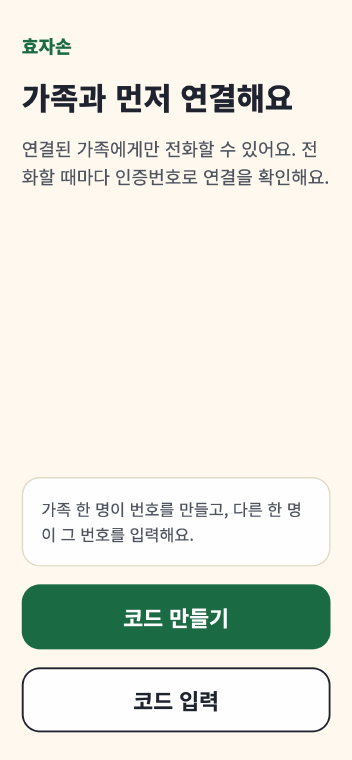
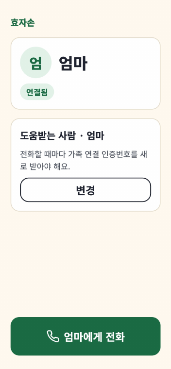
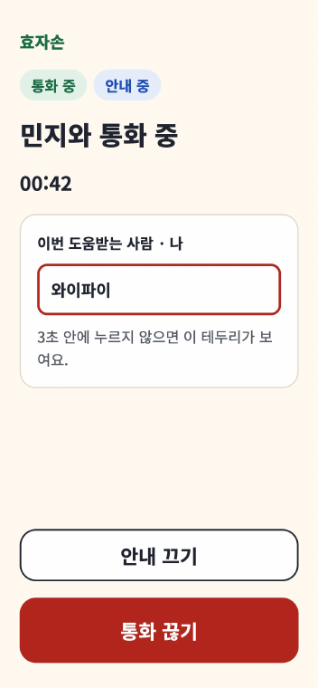

# 효자손 · Hyojason

**가족이 통화로 말한 버튼을 3초 안에 누르기 어려울 때, 화면에서 찾아 짚어 주는 Android Agent입니다.**

Trillion Labs Hackathon Track 1을 위한 프로토타입입니다. 가족은 효자손에서 연결하고 통화합니다. 도움받는 사람은 설정이나 시계처럼 평소 쓰는 앱에서 직접 조작합니다.

## 앱 디자인

| 가족 연결 | 도움받는 사람 선택 | 통화 중 안내 |
|:---:|:---:|:---:|
|  |  |  |

[전체 앱 디자인 레이아웃 PDF](docs/assets/app-design/hyojason-app-layout.pdf)에는 번호 발급, 연결 승인, 수신 화면을 포함한 6개 목업이 담겨 있습니다. 위 화면은 앱 디자인 시안입니다.

1. **새 도움을 연결합니다.** 한 사람이 일회용 인증번호를 만들고 상대가 입력합니다. 양쪽이 승인하면 이번 도움 동안만 연결됩니다. 연결 상태는 서버 메모리에서 관리합니다.
2. **이번에 도움받는 사람을 확인합니다.** 통화 전에 부모님이나 자녀를 선택하는 흐름으로 설계했습니다. 발신 방향과 도움 대상은 각각 정해집니다. [지원 대상 선택 설계 이슈](https://github.com/Bungeo-BeanOrCream/Hyojason/issues/6)
3. **통화하고 직접 조작합니다.** 3초 안에 올바르게 누르면 화면 그대로 진행합니다. 근거가 확인되면 도움받는 기기에서 버튼을 짚거나 화면 내리기·뒤로 가기를 안내합니다.
4. **이번 도움을 마칩니다.** 통화가 끝나도 목표가 남으면 같은 도움을 이어갑니다. 도움을 완료하거나 안내를 끄면 임시 연결이 끝나고, 다음 도움에는 새 번호를 사용합니다.

## 데모 시나리오

| 장면 | 동작 |
|---|---|
| **통화 중 · 설정** | 자녀의 버튼 지시를 3초 안에 따르면 표시 없이 진행합니다. 막히면 확인된 버튼이나 화면 내리기·뒤로 가기를 안내합니다. |
| **통화 후 · 알람** | 자녀가 알람 목표와 첫 지시를 말합니다. 통화가 끝나도 부모님은 설정을 이어갑니다. 도착이 추정되면 자녀에게 알리고, 자녀가 도움 완료를 누릅니다. |

화면은 동의한 기기에서 분석합니다. 상대방 화면에는 화면 영상, AI가 인식한 지시, 조작 내역이 표시되지 않습니다.

Zoro-1은 목표, 버튼 위치, 지시 수행 여부를 판단합니다. 통화가 끝난 뒤에는 다음 행동과 목표 도착을 판단합니다. 데모 환경은 Android Studio 에뮬레이터 두 대와 LiveKit 음성 통화로 구성합니다. [Zoro-1](https://huggingface.co/trillionlabs/Zoro-1) · [LiveKit](https://docs.livekit.io/transport/) · [대회 안내](https://hackathon.trillionlabs.co/)

[개발 설계](docs/README.md) · [지원 목표와 데모](docs/scenarios.md) · [실험 계획](docs/verification-plan.md)
