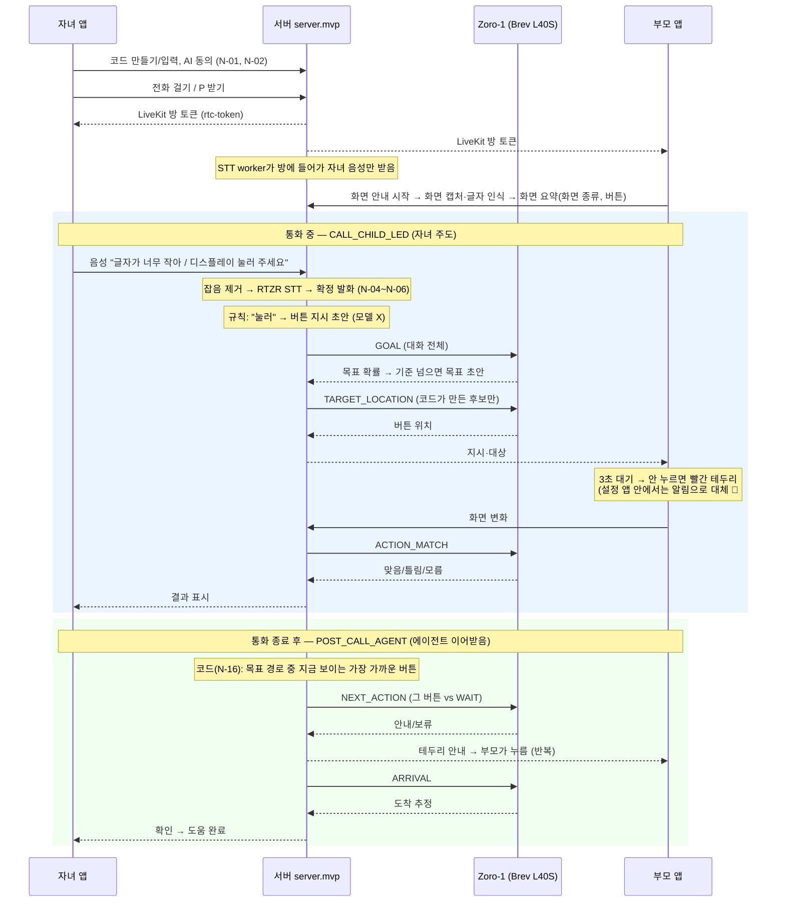

# 효자손: Zoro-1 사용 위치와 전체 판단 흐름

작성: 2026-11-20 · 기준: 저장소 `main`(cd602ae) 코드·노드 문서 + 직접 실행 확인 · 담당 B

> 표기: ✅ 직접 실행해 확인 / 📄 코드·문서만 읽고 정리 / 👥 팀원 확인 내용(직접 보지 않음)

## 1. Zoro-1은 어디에 있나

| 항목 | 내용 | 확인 |
|---|---|---|
| 서빙 위치 | NVIDIA Brev GPU 인스턴스 `hyojason-zoro` (L40S 48GB, org `TL-Hackathon-team1`, ID `rq2jv3z7t`) | ✅ |
| 엔드포인트 | VM 내부 `127.0.0.1:30001/v1/decide` — `decider_http.py` (`~/workspace/hyojason-zoro-smoke`) | ✅ |
| 외부 접속 | 공개 포트 없음. `brev port-forward hyojason-zoro -p 9000:30001` → Mac `localhost:9000` | ✅ |
| VM 통합 백엔드 | `127.0.0.1:18002` — `server.mvp` (VM 내부에서 Zoro-1 호출) | ✅ |
| 모델 revision | `bf1b76b9b4df03b05fcbb73444e1cd4db0f566da` (응답 revision이 다르면 버림) | ✅ |
| 설정 | `ZORO_DECIDE_URL`, `ZORO_MODEL_REVISION`, (프록시면) `ZORO_DECIDE_TOKEN` | ✅ |

## 2. 호출 방식 — 공통 입구 N-14 (`server/agent/infer_zoro_choice.py`) ✅

Zoro-1은 글을 생성하지 않고 **주어진 선택지 중 하나를 확률로 고르는 Decision 모델**로만 쓴다. 모든 호출이 이 파일 한 곳을 지난다.

```json
// 요청
{"request": {"state": {…상황…},
             "questions": {"decision": {"type": "choice",
                                        "instructions": "질문",
                                        "criteria": {"SET_FONT": "설정에서 글자 크기를 키우기", "NONE": "명시적인 지원 목표 없음"}}}},
 "reasoning": false}
// 응답
{"answers": {"decision": {"type": "choice", "choice": "SET_FONT",
                          "probabilities": {"SET_FONT": 0.967, "NONE": 0.032}}}}
```

- 검사: 선택지 밖 답, 확률 형식 오류, revision 불일치, 제한 시간 초과(노드 기본 1000ms) → 오류(`INVALID_MODEL_RESPONSE`, `TIMEOUT`, `DEPENDENCY_UNAVAILABLE`).
- **채택 기준** `approved_selection`: 1위 ≥ **0.70** 그리고 1위−2위 ≥ **0.15**. 못 넘으면 모름/보류.
- 같은 Basis(버전 정보)·같은 질문은 캐시해 재호출하지 않는다.

## 3. Zoro-1에게 하는 5가지 질문

| 질문 | 노드·파일 | 모드 | 언제 | 선택지 | 확인 |
|---|---|---|---|---|---|
| **GOAL** | N-15 `interpret_child_turn.py` | 통화 중 | 확정 발화마다 | 목표 6개 + `NONE` | ✅ |
| **TARGET_LOCATION** | N-27 `locate_child_instruction_target.py` | 통화 중 | 자녀가 "○○ 눌러" 지시 | 그 버튼(현재 화면/화면 아래) vs `UNKNOWN` | 📄 |
| **ACTION_MATCH** | N-28 `assess_instruction_follow_through.py` | 통화 중 | 부모 조작으로 화면이 바뀜 | `CORRECT` / `WRONG` / `UNKNOWN` | 📄 |
| **NEXT_ACTION** | N-17 `choose_post_call_action.py` | 통화 후 | 승인된 목표가 남음 | 다음 버튼(또는 뒤로) vs `WAIT` | ✅(시뮬레이션) |
| **ARRIVAL** | N-18 `assess_post_call_arrival.py` | 통화 후 | 화면에 완료 근거 | 도착 / 아직 | 📄 |

목표 6개(`profiles.GOAL_LABELS`): `SET_FONT` 글자 크기, `SET_TIMEOUT` 자동 꺼짐 10분, `CLOCK_ALARM` 알람, `MAP_ROUTE` 길찾기, `SMS_SEND` 문자, `MAIL_OPEN` 메일.

## 4. 전체 흐름



## 5. 모델이 정하는 것 vs 코드가 정하는 것

| Zoro-1 (확률) | 코드 (규칙·고정) |
|---|---|
| 어떤 목표인지 (GOAL) | 목표 목록, 슬롯 값(시각·날짜 등, 정규식) |
| 지시한 버튼이 지금 보이는지 (TARGET_LOCATION) | 버튼 이름 해석("디스플레이" → `settings.display`) |
| 지시대로 눌렀는지 (ACTION_MATCH) | 화면 인식(글자로 화면 종류·버튼 판별, `DemoProfiles.kt`) |
| 다음 버튼을 지금 안내할지 (NEXT_ACTION) | **목표까지의 경로**(`GOAL_ROUTES`), 후보를 가장 가까운 버튼 하나로 좁히기 |
| 도착했는지 (ARRIVAL) | 위험 요청 차단(송금·비밀번호 등), 3초 대기, 테두리 그리기 |

모델은 **항상 코드가 걸러 준 선택지 안에서만** 고른다. 엉뚱한 버튼을 안내할 위험은 낮지만, 경로를 모델이 스스로 찾지는 않는다. NEXT_ACTION의 확신도는 "이 버튼이 맞을 확률"보다 "지금 이 버튼을 안내해도 될 확신"에 가깝다.

## 6. 테스트 도구(`server/ops/try_*.py`)가 대신하는 부분

| 실제 앱 | 테스트 도구 |
|---|---|
| 음성 → LiveKit → RTZR STT → 확정 발화 | 터미널에 입력한 문장을 확정 발화로 넣음 |
| 서버(`server.mvp`)·세션 상태 | 노드(N-15~N-17)를 직접 호출 |
| 부모 앱 화면 캡처·글자 인식 | adb `uiautomator` 글자 읽기 (`try_emulator`) / `profiles.py` 가짜 화면 (`try_navigation`) |
| 부모 앱 안내 테두리 | 같은 그리기 코드(`AndroidSurfaceHost`)를 debug 수신기로 호출 |
| 통화 중 판단 | 통화 후 모드(NEXT_ACTION)로 진행 |

실행 로그: `logs/agent-runs/*.jsonl` (`server/ops/_runlog.py`). 자세한 사용법은 [`B-zoro-emulator-handoff.md`](B-zoro-emulator-handoff.md).

## 7. 실측 결과 (LIVE)

| 문장 | 결과 | 비고 |
|---|---|---|
| 글자가 너무 작아 | SET_FONT 0.967 (NONE 0.032) | 2회 동일 |
| 내일 아침 여섯 시에 일어나야해 | CLOCK_ALARM 0.791 (NONE 0.204) | 기준선 근처, 슬롯 tomorrow 06:00 |
| (통화 경로) 자녀 수락 후 | `통화에 연결하지 못했어요 (rtc-token DEPENDENCY_UNAVAILABLE)` | VM 18002에 LiveKit 키 없음 |
